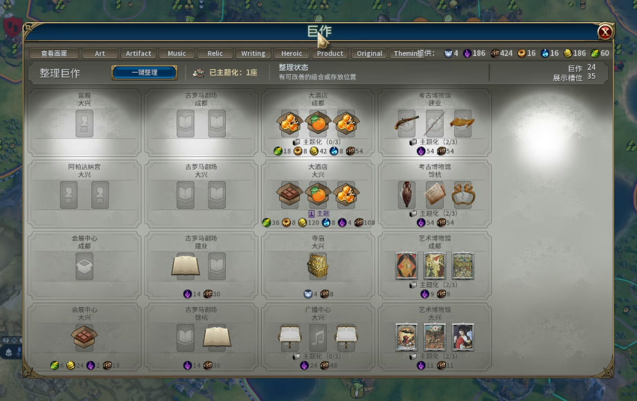
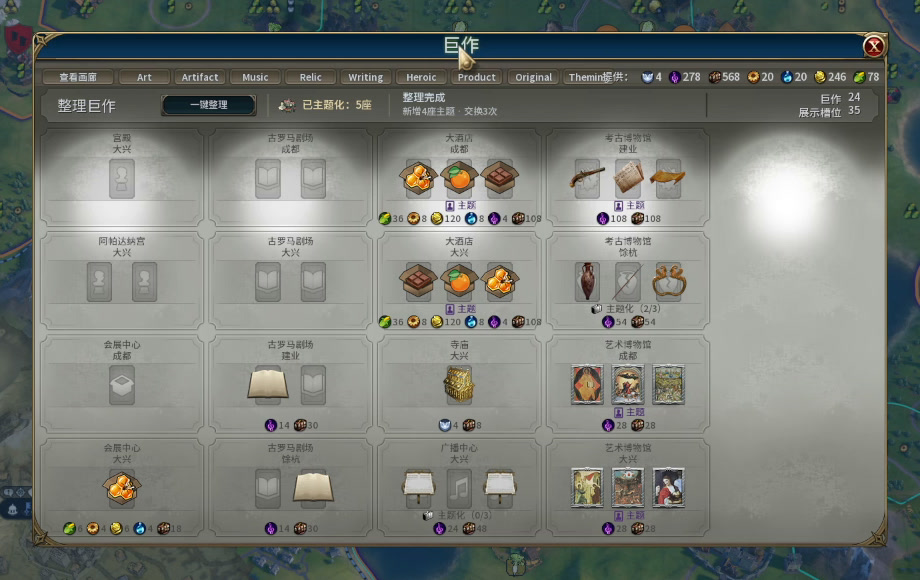

# Great Works Auto Theming

[简体中文](README.zh-CN.md) · **English** · [Steam Workshop](https://steamcommunity.com/sharedfiles/filedetails/?id=3840337211)

Arrange the Great Works you already own with one click in Civilization VI. AutoTheme preserves existing themes, attempts new themed combinations first, and then improves supported placements for the remaining collection.

[](https://www.youtube.com/watch?v=MuCYF0KRlxY)

[Watch the 28-second gameplay demo](https://www.youtube.com/watch?v=MuCYF0KRlxY)

## Current release

**0.3.0-mp.3 · Single-player and multiplayer (beta).**

All players should use the same mod version for multiplayer. Each player arranges their own collection. See [multiplayer use](docs/MULTIPLAYER.md).

- Scans actual works and slots across the Great Works panel, including art, artifacts, relics, writing, music, corporation products and standard mod-added types.
- Uses native move requests one at a time and waits for the actual slot contents before continuing.
- Respects existing themes, art cooldowns, archaeological transfer constraints and legal slot types.
- Click Stop or close the panel to stop after the pending exchange. Completed exchanges are retained.

In this gameplay demo, the same 24-work collection increased from one themed building to five in three swaps.

### Before



### After



Names, descriptions, in-game controls and messages support Simplified Chinese and English, following the game language.

## Installation & use

Subscribe on Steam and enable **Great Works Auto Theming** in Additional Content → Mods. During your turn, open Great Works and click Theme Great Works. For multiplayer, have all players update to the same version before starting or joining a game; see [multiplayer use](docs/MULTIPLAYER.md).

For manual installation, exit the game and copy `mod/` into your Civilization VI `Mods` directory, naming the copied folder `AutoTheme`.

Great Work theming is part of base Civilization VI. AutoTheme does not require Harmony in Diversity; it uses the works, buildings and slot rules in the current game and can also be used alongside HD.

## Development

The [source comparison and code review](docs/MULTIPLAYER_CODE_REVIEW.zh-CN.md) covers Great Works Viewer, CQUI/Better Trade Screen, Multiplayer Helper and the native UI. Verification details are kept in the [technical records](docs/VERIFICATION.md).

```sh
python scripts/verify.py
npm ci
python scripts/test.py
python scripts/package.py
```

`mod/` contains installable Lua/XML; `tests/` contains offline regressions; `workshop/` contains the public release's cover, bilingual descriptions and gameplay images. The ZIP is written to `dist/AutoTheme-0.3.0-mp.3.zip`. See [detailed rules](docs/BEHAVIOR.zh-CN.md) and [verification records](docs/VERIFICATION.md) for implementation and testing details.

## Contributing & license

Use [Issues](https://github.com/civs6-mods/AutoTheme/issues) for bug reports and feature suggestions. Include game version, DLC, enabled mods, reproduction steps and relevant `Lua.log` or `Modding.log` errors. Pull requests for translations, tests and Lua/UI improvements are welcome.

Original project code is [MIT licensed](LICENSE). Civilization VI screenshots and game content remain the property of their respective rights holders. Demo music has its own attribution license; see [music credits](docs/MUSIC-CREDIT.txt). This is not an official Firaxis, 2K, Aspyr or HD release.
