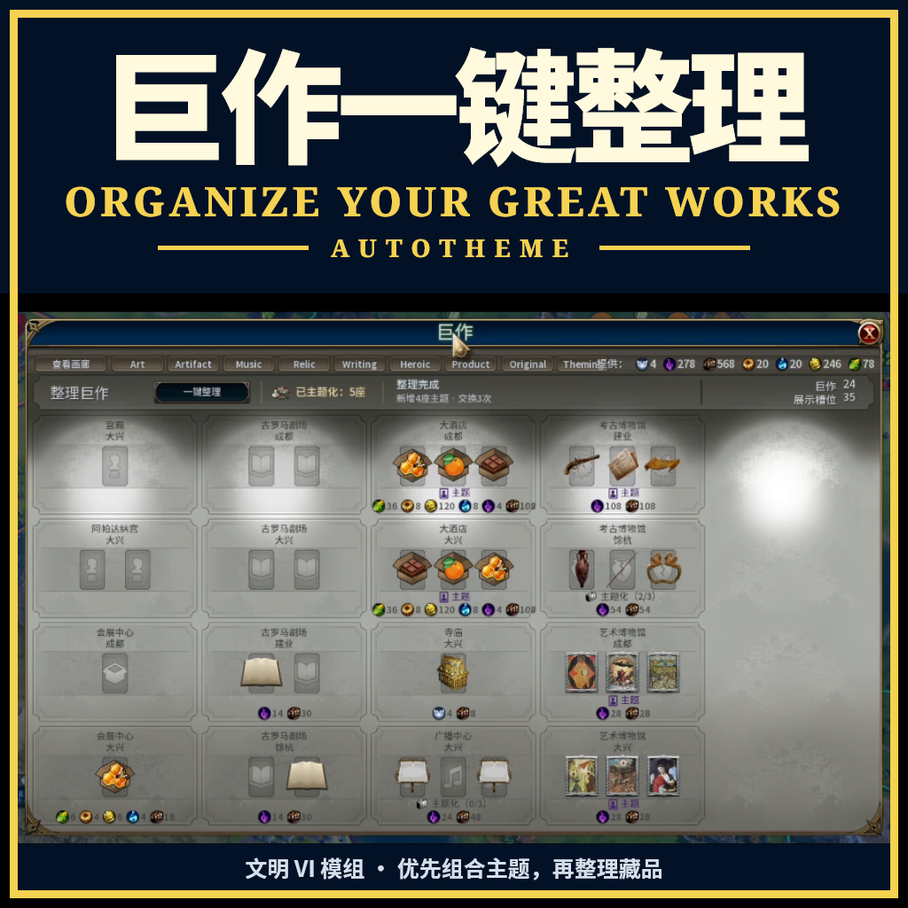

# AutoTheme — Arrange Great Works

[简体中文](README.zh-CN.md) · **English** · [Steam Workshop](https://steamcommunity.com/sharedfiles/filedetails/?id=3840337211)

Arrange the Great Works you already own with one click in Civilization VI. AutoTheme preserves existing themes, attempts new themed combinations first, and then improves supported placements for the remaining collection.



## Current release

**0.2.4 · single-player preview**, publicly available on Steam. `mod/` matches the verified seven-file release package (manifest 7).

- Scans actual works and slots across the Great Works panel, including art, artifacts, relics, writing, music, corporation products and standard mod-added types.
- Uses native move requests one at a time and waits for the actual slot contents before continuing.
- Respects existing themes, art cooldowns, archaeological transfer constraints and legal slot types.
- Click Stop or close the panel to stop after the pending exchange. Completed exchanges are retained.
- Bounded heuristics do not guarantee a globally optimal result or support every custom third-party theme script.

The demo's 24-work collection increased from one themed building to five in three swaps. This is one real-game example, not a guaranteed improvement for every save. See [verification and limits](docs/VERIFICATION.md).

## Installation & use

Subscribe on Steam, wait for the download, then enable **Auto Theme** in Additional Content → Mods. During your turn, open Great Works and click Arrange Great Works.

For manual installation, exit the game and copy `mod/` into your Civilization VI `Mods` directory, naming the copied folder `AutoTheme`. Keep only one installation method because the local and Workshop copies share the same mod ID.

The target setup is Gathering Storm with Harmony in Diversity. Partial testing covers one HD collection; other combinations are unverified. Multiplayer and hotseat are unsupported. This mod organizes existing works; it does not produce products, excavate artifacts or trade other civilizations' works.

## Development

```sh
python scripts/verify.py
npm ci
python scripts/test.py
python scripts/package.py
```

`mod/` contains installable Lua/XML; `tests/` contains offline regressions; `workshop/` contains the cover, bilingual descriptions and gameplay images. The ZIP is written to `dist/AutoTheme-0.2.4.zip`. Detailed rules are available in [Chinese](docs/BEHAVIOR.zh-CN.md).

## Contributing & license

Use [Issues](https://github.com/civs6-mods/AutoTheme/issues) for bug reports and feature suggestions. Include game/DLC/HD versions, enabled mods, reproduction steps and relevant `Lua.log` or `Modding.log` errors. Pull requests for translations, tests and Lua/UI improvements are welcome.

Original project code is [MIT licensed](LICENSE). Civilization VI screenshots and game content remain the property of their respective rights holders. Demo music has its own attribution license; see [music credits](docs/MUSIC-CREDIT.txt). This is not an official Firaxis, 2K, Aspyr or HD release.
