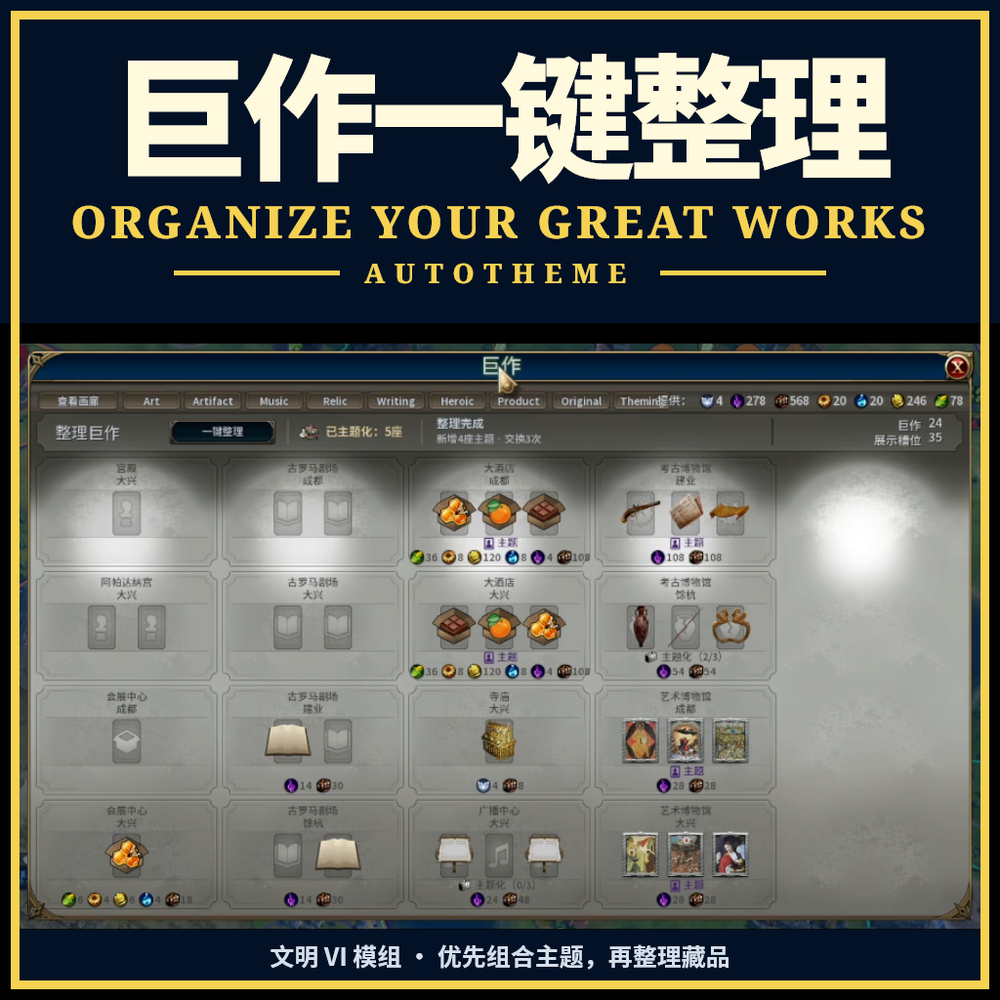
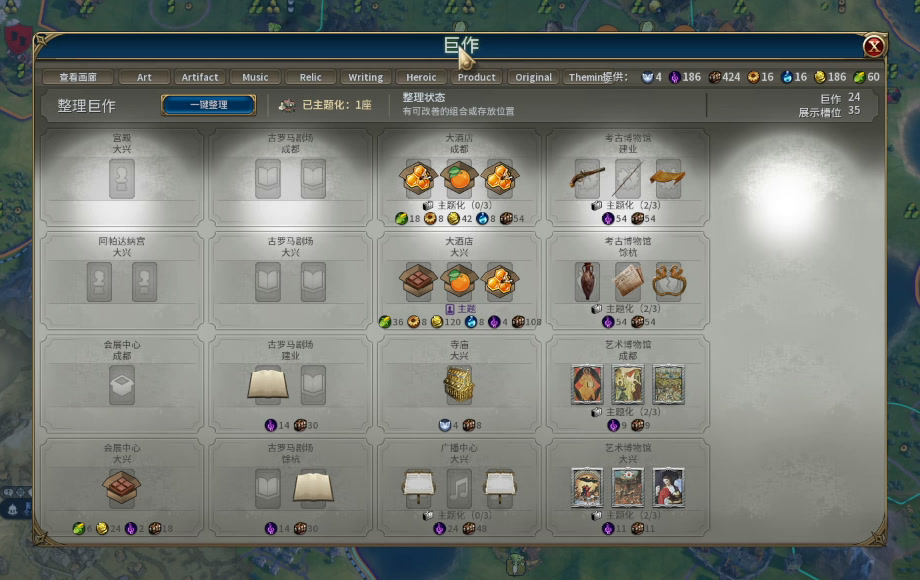
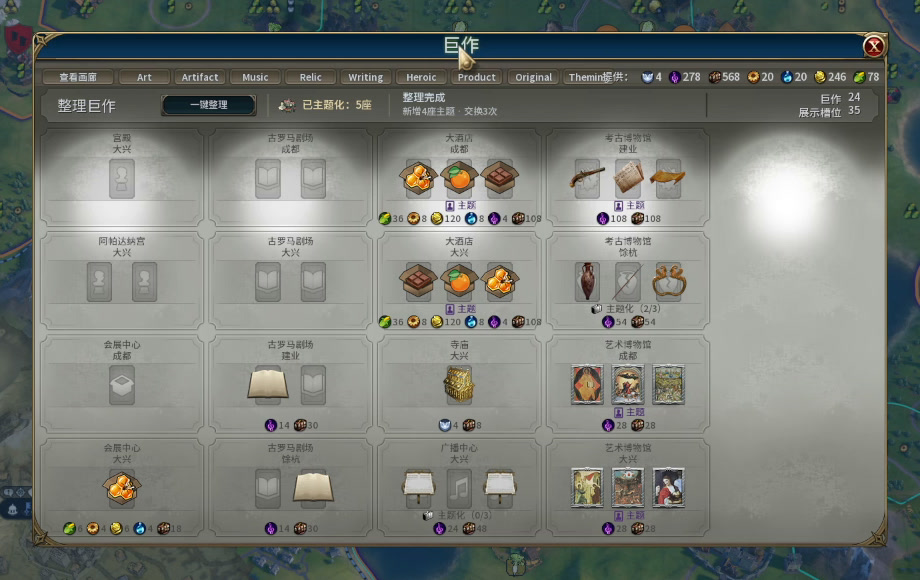

# 巨作一键主题化 / Great Works Auto Theming

[English](README.md) · [Steam 创意工坊](https://steamcommunity.com/sharedfiles/filedetails/?id=3840337211) · [详细规则](docs/BEHAVIOR.zh-CN.md)

在《文明 VI》中点击一次，整理自己已经拥有的巨作。保留已有主题，先尝试组合新主题，再改善其余藏品的存放位置。

[](https://www.youtube.com/watch?v=MuCYF0KRlxY)

[观看 28 秒实机演示](https://www.youtube.com/watch?v=MuCYF0KRlxY)

## 当前版本

**0.3.0-mp.3 · 支持单机与联机（联机测试版）。**

联机玩家请使用相同版本，每位玩家只整理自己的藏品。使用方法见[联机说明](docs/MULTIPLAYER.md)。

- 扫描整个巨作面板的实际作品与合法槽位，包含艺术品、文物、遗物、著作、音乐、公司及奇观产品等。
- 通过原生移动指令逐笔交换，确认实际槽位内容后再继续。
- 保留已有主题，遵守艺术品冷却、文物馆满槽转移及槽位类型限制。
- 点击停止或关闭窗口，等待已提交的一笔完成后停止；已完成交换保留。

演示中，同一批 24 件藏品经过三次交换，主题由 1 座变为 5 座。

### 整理前



### 整理后



名称、简介、游戏内按钮与提示支持简体中文和英语，跟随游戏语言自动切换。

## 安装与使用

订阅工坊，在“额外内容 → 模组”启用“巨作一键主题化 / Great Works Auto Theming”。进入自己的回合，打开巨作窗口，点击“一键主题化”。联机前请所有玩家更新到相同版本，具体见[联机说明](docs/MULTIPLAYER.md)。

手动安装：退出游戏，将本仓库的 `mod` 文件夹复制到游戏 `Mods` 目录，并命名为 `AutoTheme`。

巨作主题化是《文明 VI》本体已有机制，并非《风云变幻》或《和而不同》特有功能。AutoTheme 不依赖《和而不同》，按当前游戏中实际作品、建筑与槽位规则整理；也可与《和而不同》搭配使用。

## 开发、验证与打包

参考实现与技术细节见[代码审查](docs/MULTIPLAYER_CODE_REVIEW.zh-CN.md)，验证范围见[技术记录](docs/VERIFICATION.md)。

```sh
python scripts/verify.py
npm ci
python scripts/test.py
python scripts/package.py
```

`mod/` 为可安装源码，`tests/` 为离线回归，`workshop/` 为公开版的封面、双语介绍与实机截图。生成包位于 `dist/AutoTheme-0.3.0-mp.3.zip`。实现细节与测试记录见[详细规则](docs/BEHAVIOR.zh-CN.md)和[验证记录](docs/VERIFICATION.md)。

## 参与开发与许可

欢迎通过 [Issues](https://github.com/civs6-mods/AutoTheme/issues) 反馈问题与建议，提供游戏版本、DLC、启用模组、复现步骤及日志报错。也欢迎参与翻译、测试和 Lua / UI 开发并提交 Pull Request。

原创代码采用 [MIT](LICENSE)。游戏截图及游戏内容的权利归各自权利人；演示配乐另按其授权署名，见[配乐说明](docs/MUSIC-CREDIT.txt)。非 Firaxis、2K、Aspyr 或 HD 官方作品。
